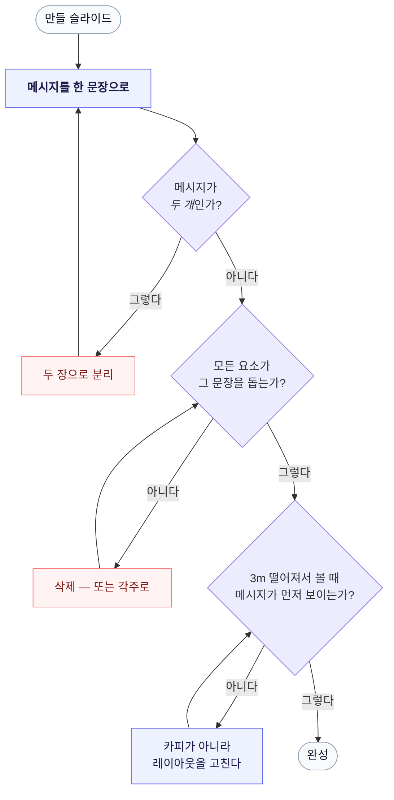

# slide-skill

**슬라이드 하나에 메시지 하나. 두 개면 슬라이드 두 장.**

*[English README](README.md)*

Claude Code, Claude 앱, Codex가 **읽히는 슬라이드**를 만들도록 하는 Agent Skill입니다.
Alexei Kapterev의 *Death by PowerPoint* 원칙 — 중요성(significance), 구조(structure),
단순함(simplicity) — 을 에이전트가 초안을 잡는 동안 실제로 따르는 규칙으로 바꾸고,
슬라이드를 내보내기 전 여섯 개의 체크리스트를 돌립니다.

API 키도, 의존성도, 스크립트도 없습니다. `SKILL.md` 파일 하나가 전부입니다.

`.pptx`, HTML 덱, PDF 어디에나 적용되고 언어도 가리지 않습니다. "발표자료 만들어줘",
"덱 만들자", "이 슬라이드 너무 복잡해" 같은 한국어 표현에도 그대로 걸립니다.

---

## 무엇이 달라지나

스킬이 없으면 에이전트는 요청한 내용을 **그대로** 만듭니다. 언급한 사실 전부를,
한 장에, 표로. 스킬이 있으면 먼저 쪼개고, 장식은 하지 않습니다.

| 이렇게 하는 대신 | 이렇게 만듭니다 |
|---|---|
| 누가 몇 라운드를 통과했는지 6×5 표 | 점이 줄어드는 퍼널, 생존자만 강조 |
| 다섯 가지 장점을 불릿으로 나열 | 다섯 줄, 각 줄에 굵은 명사 하나 + 설명 한 줄 |
| 차트 두 개 + 메모 + 표 | 슬라이드 세 장 |
| 부제목에 문단 하나 | 20단어 이내 한 문장 |
| 작동 원리를 글로 설명 | 작동 원리를 **그림으로** |

"너무 복잡해"라고 하면 폰트를 줄이는 대신 **내용을 덜어냅니다.**



**핵심은 3미터 테스트입니다.** 본문을 읽어야 무슨 슬라이드인지 알 수 있다면 레이아웃이
잘못된 것입니다. 문장을 아무리 고쳐 써도 해결되지 않습니다.

---

## 설치

### 가장 빠른 방법 — 에이전트에게 URL을 넘기기

Claude Code, Claude 앱, Codex에 이렇게 붙여넣으세요:

```
Install this skill for me: https://github.com/hunkim/slide-skill
```

에이전트가 [INSTALL.md](INSTALL.md)를 따라 호스트와 OS에 맞는 디렉터리를 고르고,
클론하고, 파일이 제대로 들어갔는지 확인합니다. 이후 설정할 것은 없습니다.

에이전트가 웹을 못 읽는다면 파일을 직접 주세요:
<https://raw.githubusercontent.com/hunkim/slide-skill/main/INSTALL.md>

### 직접 설치

<details open>
<summary><b>Claude Code</b></summary>

```bash
git clone https://github.com/hunkim/slide-skill.git ~/.claude/skills/slide-design
```

특정 프로젝트에서만 쓰려면 `~/.claude/skills` 대신 저장소 안의 `.claude/skills`에
클론하세요. 다음 세션부터 인식됩니다.
</details>

<details>
<summary><b>Codex CLI</b></summary>

```bash
git clone https://github.com/hunkim/slide-skill.git ~/.codex/skills/slide-design
```

팀과 공유하려면 `.agents/skills/slide-design`에 넣고 커밋하세요. Codex는 스킬 디렉터리를
자동으로 훑습니다. 안 보이면 Codex를 재시작하세요.
</details>

<details>
<summary><b>Claude 앱 (Cowork)</b></summary>

저장소를 zip으로 묶고 확장자를 `.skill`로 바꾼 뒤, 채팅창에 첨부하고 저장하세요.

```bash
git clone https://github.com/hunkim/slide-skill.git slide-design
rm -rf slide-design/.git
zip -Xr slide-design.skill slide-design
```
</details>

<details>
<summary><b>Windows (PowerShell)</b> — 홈은 <code>C:\Users\&lt;이름&gt;</code></summary>

과정은 같고 경로만 다릅니다. `~`는 `$env:USERPROFILE`로 읽으세요.

```powershell
# Claude Code
git clone https://github.com/hunkim/slide-skill.git "$env:USERPROFILE\.claude\skills\slide-design"

# Codex CLI
git clone https://github.com/hunkim/slide-skill.git "$env:USERPROFILE\.codex\skills\slide-design"
```

Claude 앱용 `.skill` 패키징:

```powershell
git clone https://github.com/hunkim/slide-skill.git slide-design
Remove-Item -Recurse -Force slide-design\.git
Compress-Archive -Path slide-design -DestinationPath slide-design.zip
Rename-Item slide-design.zip slide-design.skill
```
</details>

> 클론 디렉터리 이름은 `slide-skill`이 아니라 `slide-design`입니다. 호스트가 폴더 이름을
> 스킬의 `name:` 필드와 맞춰 보기 때문입니다. 저장소 이름은 `slide-skill`, 그 안의 스킬
> 이름은 `slide-design`입니다.

---

## 사용법

그냥 슬라이드를 요청하면 됩니다. 스킬이 알아서 로드됩니다:

```
이 리포트를 10장짜리 덱으로 만들어줘.
발표자료 만들어줘 — 15분, 임원 대상.
4번 슬라이드 너무 복잡해.
이 덱 다시 봐줘.
```

이미 만들어 둔 덱에 규칙만 적용하고 싶다면 `slide-design 스킬 써서 봐줘`처럼 이름을
직접 부르셔도 됩니다.

**결과물은 하나가 아니라 둘입니다.** 청중에게 디테일이 필요하면 스킬은 시각적인
슬라이드와 **별도 문서**를 따로 만들게 합니다. 덱이면서 동시에 유인물인 파일은 양쪽 다
실패합니다.

---

## 안에 무엇이 있나

| `SKILL.md`의 섹션 | 다루는 내용 |
|---|---|
| The one rule | 슬라이드 하나에 메시지 하나 — 만들기 전에 문장부터 |
| Death by PowerPoint | 중요성, 구조(이유는 3~4개), 단순함 |
| What this means in practice | 위의 교체 표, 그리고 3미터 테스트 |
| Checklist | 내보내기 전 돌리는 여섯 개 질문 |
| "Too complex" | 내용을 덜어낸다. 폰트는 절대 줄이지 않는다 |
| Building HTML decks | 1280×720 스테이지, 하나의 디자인 시스템, SVG 차트, 단일 파일, Playwright 검증 |

HTML 섹션이 특히 깐깐한 이유는 에이전트가 가장 자주 무너지는 지점이기 때문입니다 —
다크와 라이트 슬라이드를 섞고, 차트를 스크린샷으로 붙이고, 3D 전환을 넣고, 넘치는
텍스트를 아무도 재보지 않습니다. 그래서 마지막이 Playwright 검증입니다: 전 슬라이드
스크린샷, JS 에러 0, 빈 슬라이드 0, 컨테이너를 넘치는 요소 0.

---

## 출처

원칙은 Alexei Kapterev의 *Death by PowerPoint*(조회수 약 500만)에서 왔습니다 —
<https://www.slideshare.net/slideshow/death-by-powerpoint/85551>. 이 스킬은 그 원칙을
에이전트가 실행할 수 있는 지시문으로 다시 쓴 것이며, 원본 덱의 사본이 아닙니다.

## 라이선스

MIT — [LICENSE](LICENSE) 참고.
