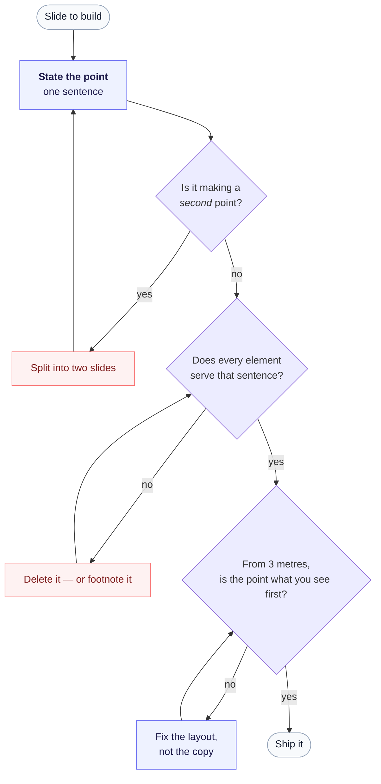

# slide-skill

**One point per slide. Everything else is a second slide.**

*[한국어 README](README.ko.md)*

An Agent Skill that makes Claude Code, the Claude app, or Codex build slides people can
actually read. It applies Alexei Kapterev's *Death by PowerPoint* principles —
significance, structure, simplicity — as working rules the agent follows while it drafts,
plus a six-question checklist it runs before shipping each slide.

No API key, no dependencies, no scripts. It is one `SKILL.md` file: pure judgment the
agent loads when you ask for slides.

Works for `.pptx`, HTML decks, and PDF exports, in any language. Triggers on English and
Korean alike — "make a deck", "발표자료 만들어줘", or a slide coming back as "복잡해".

---

## What changes

Without the skill, agents build the deck you literally asked for: every fact you mentioned,
on one slide, in a table. With it, they split first and decorate never.

| Instead of | You get |
|---|---|
| A 6×5 table of who passed which round | A funnel of shrinking dots, survivor highlighted |
| A bullet list of five benefits | Five rows, one bold noun each, one line of support |
| Two charts + notes + a table | Three slides |
| A paragraph as the subtitle | One sentence, ≤ 20 words |
| Explaining the mechanism in text | A drawing of the mechanism |

And when you say "too complex", it removes content instead of shrinking the font.



**The 3-metre test is the one that catches everything.** If you have to read body copy to
learn what the slide is about, the layout is wrong — no amount of rewriting the text will
fix it.

---

## Install

### The quick way — hand the URL to your agent

Paste this into Claude Code, the Claude app, or Codex:

```
Install this skill for me: https://github.com/hunkim/slide-skill
```

The agent follows [INSTALL.md](INSTALL.md): it picks the right directory for your host and
OS, clones, and verifies the file landed. Nothing to configure afterwards.

If your agent can't browse, hand it the file directly:
<https://raw.githubusercontent.com/hunkim/slide-skill/main/INSTALL.md>

### By hand

<details open>
<summary><b>Claude Code</b></summary>

```bash
git clone https://github.com/hunkim/slide-skill.git ~/.claude/skills/slide-design
```

For one project only, use `.claude/skills` inside the repo instead of `~/.claude/skills`.
It is picked up on the next session.
</details>

<details>
<summary><b>Codex CLI</b></summary>

```bash
git clone https://github.com/hunkim/slide-skill.git ~/.codex/skills/slide-design
```

To commit it and share with your team, put it in `.agents/skills/slide-design`.
Codex scans skill directories automatically; restart Codex if it doesn't show up.
</details>

<details>
<summary><b>Claude app (Cowork)</b></summary>

Zip this repository, rename it to `.skill`, attach it in the chat window, and save.

```bash
git clone https://github.com/hunkim/slide-skill.git slide-design
rm -rf slide-design/.git
zip -Xr slide-design.skill slide-design
```
</details>

<details>
<summary><b>Windows (PowerShell)</b> — home is <code>C:\Users\&lt;name&gt;</code></summary>

Same steps, different paths. Read `~` as `$env:USERPROFILE`.

```powershell
# Claude Code
git clone https://github.com/hunkim/slide-skill.git "$env:USERPROFILE\.claude\skills\slide-design"

# Codex CLI
git clone https://github.com/hunkim/slide-skill.git "$env:USERPROFILE\.codex\skills\slide-design"
```

Packaging a `.skill` for the Claude app:

```powershell
git clone https://github.com/hunkim/slide-skill.git slide-design
Remove-Item -Recurse -Force slide-design\.git
Compress-Archive -Path slide-design -DestinationPath slide-design.zip
Rename-Item slide-design.zip slide-design.skill
```
</details>

> The clone directory is `slide-design`, not `slide-skill` — hosts match the folder name
> against the skill's `name:` field. The repo is named `slide-skill`; the skill inside it
> is `slide-design`.

---

## Use it

Just ask for slides. The skill loads on its own:

```
Turn this report into a 10-slide deck.
발표자료 만들어줘 — 15분짜리, 임원 대상.
Slide 4 is too complex.
이 덱 다시 봐줘, 너무 복잡해.
```

You can also invoke it by name — `use the slide-design skill` — when you want the rules
applied to a deck you already have.

**Two artifacts, not one.** If the audience needs the detail, the skill has the agent ship
visual slides *plus* a separate document. A file trying to be both a deck and a handout
fails at both.

---

## What's inside

| Section of `SKILL.md` | What it governs |
|---|---|
| The one rule | One point per slide — write the sentence before building |
| Death by PowerPoint | Significance, structure (3–4 reasons), simplicity |
| What this means in practice | The swap table above, plus the 3-metre test |
| Checklist | Six questions to run before shipping any slide |
| "Too complex" | Remove content; never shrink the font |
| Building HTML decks | 1280×720 stage, one design system, SVG charts, self-contained file, Playwright verification |

The HTML section is opinionated because HTML decks are where agents go wrong most often —
mixed dark and light slides, pasted chart screenshots, 3D transitions, overflowing text
nobody measured. It closes with a Playwright check: screenshot every slide, assert zero JS
errors, zero blank slides, and no element overflowing its container.

---

## Credit

The principles come from Alexei Kapterev's *Death by PowerPoint* (~5M views) —
<https://www.slideshare.net/slideshow/death-by-powerpoint/85551>. This skill is a
restatement of them as instructions an agent can act on, not a copy of the deck.

## License

MIT — see [LICENSE](LICENSE).
